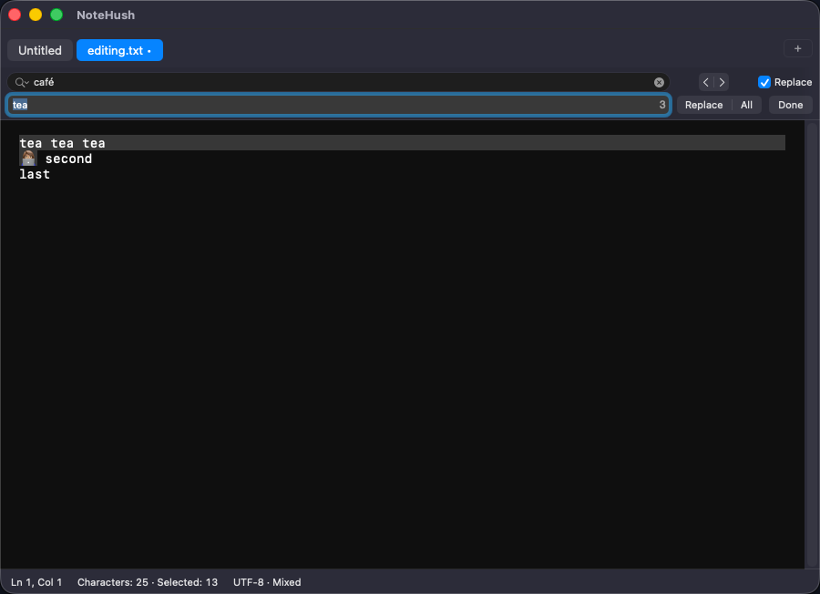
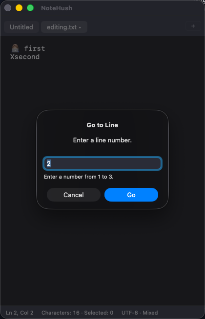

# Editing and navigation validation — 2026-09-06

Issue #8; development version 0.1.0 (1). Branch `issue-8/search-navigation-status`, based on `541e03661a764d3578c67a387508876e7801fafd`. Evidence applies to this issue branch; CI links and tested heads are recorded in its PR.

## Environment

MacBook Pro Mac16,8, Apple M4 Pro, 24 GB RAM; macOS 26.6.2 (25G83), Xcode 26.6 (17F113), Swift 6.3.3. AC power. App tests use ad-hoc signing and App Sandbox. Release archives compile arm64 and x86_64; only arm64 runtime is tested here.

## Coverage

- Core metrics: empty documents, clamped/overflow ranges, emoji, combining characters, Urdu, mixed CRLF/LF/CR/NEL/LS/PS, partial UTF-16 selections, an independent linear oracle across sparse boundaries, long lines and a 100,000-mark cluster; cancellation.
- AppKit: late results cannot replace newer metrics; inactive-tab cancellation; caret changes do not rebuild; Go to Line validates pending indices, bounds, overflow and invalid input.
- UI: native Find and next/previous wrap, Ignore Case, replace one/all, per-tab undo, source bytes unchanged, empty/no-match operations, logical Unicode line navigation, selection/count status, prompt-free quit with the navigation sheet open, minimum-width layout, and finding the last line in a generated 1,120,006-byte document before switching tabs and navigating back.
- Existing recovery, bookmark/conflict, file-panel, lifecycle and unavailable-volume cases remain in the full suite.

## Results

- `swift test` and the full script's coverage run: 56 core tests passed.
- Six child-process SIGKILL drills passed.
- Local full app run: 13 AppKit and 16 UI cases passed. The large-document UI test caught incorrect fixture expectations (localized number grouping and the fixture's character total); corrected before publication. The final targeted editing run passed all four new UI cases plus three AppKit navigation cases (7/7), with no failures.
- Unsigned Debug build and `bash scripts/archive.sh`: passed; universal arm64/x86_64 archive and version/privacy metadata verified.
- Strict Swift formatting, configuration and relative-document links: passed.
- The complete CI script, including the host-detached unavailable-volume case, must pass on the PR head before merge. Its run link and the post-merge run are recorded on the PR/issue.

## Window review

Reviewed the native Find/Replace bar and status row at 900 px, and Go to Line/status at the 420 px minimum width in dark appearance. Both images contain only synthetic fixture text inside the NoteHush window.

## Performance

`swift run -c release TextMetricsBenchmark` uses Release optimization without a debugger, generated in-memory fixtures, 20 repetitions per fixture, median/p95 (nearest-rank p95). Each query batch contains 1,000 caret, selection and go-to-line queries. Warm in-process strings; no disk-cache/launch measurements. The desktop has other applications running, so these figures are informational, not reference-hardware release gates.

| Fixture (UTF-8 bytes) | Build median / p95 (ms) | 1,000-query batch median / p95 (ms) |
| --- | --- | --- |
| Mixed Unicode, 1,020 | 0.014 / 0.027 | 47.664 / 203.059 |
| Mixed Unicode, 1,048,560 | 18.814 / 53.489 | 61.418 / 163.771 |
| Mixed Unicode, 10,485,736 | 150.420 / 309.870 | 26.172 / 69.749 |
| Single ASCII line, 10,485,760 | 214.945 / 386.152 | 10.456 / 43.485 |
| ASCII lines, 104,857,600 | 1266.037 / 2309.952 | 9.652 / 33.431 |

These are whole-batch query times, not per-query p95. Mixed fixtures repeat ASCII, emoji, Urdu, combining marks and CRLF. Timing includes ordinary shared-desktop scheduling variability; no UI test suite ran concurrently with this final benchmark.

Sampling the first implementation identified repeated canonical-equivalence newline comparisons in the hot path. Newline detection now checks scalar values; Unicode oracle tests pass after the change. No product text or external files are read by the benchmark.

## Isolation correction and limits

The prior sandboxed cold LaunchServices test did not reliably pass its workspace environment. It was opening fixture tabs in the normal development recovery workspace. No normal recovery files were deleted or rewritten as cleanup. The automated test now launches via XCTest into a UUID workspace first, sends a file request to that exact running app and verifies two tabs. Cold Finder startup needs separate host-driven or manual isolated evidence; tracked in #11. Earlier cold-start evidence does not prove isolation.

Native Find tests temporarily use the macOS Find pasteboard, preserve its existing items in memory and restore them without logging (unless another app entered a new query during the test). The general clipboard is untouched. Explicit screenshots capture only the NoteHush window; no desktop capture is used as documentation.

Whole-app launch/typing/restore latency, memory, energy, 100+ tabs and the final recovery storage design remain #12 gates. Full VoiceOver/IME/RTL interaction, light-mode and supported macOS/Intel runtime coverage remain #13 gates. Production signing, hardened runtime, TestFlight, metadata and App Review remain M6 gates. No GitHub production release or App Store upload was made.
