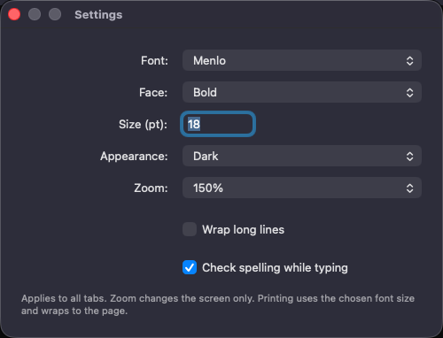
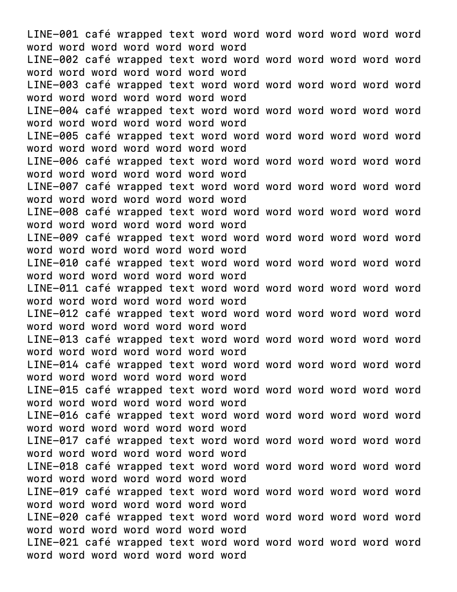
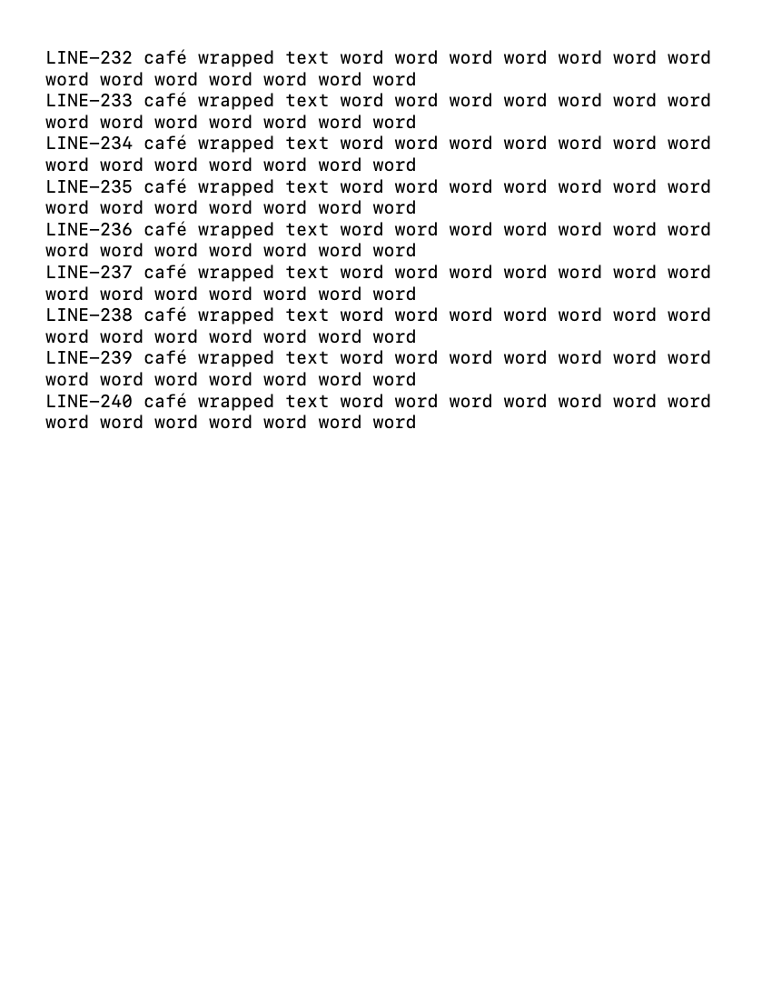

# Preferences and printing validation — issue #9

Date: 2026-09-06. Branch: `issue-9/editor-preferences-printing`, based on main `a51725b82e3ac43b947d62d48201f3fc6e8c0ba6`. Version remains 0.1.0 (1), pre-release.

Environment: MacBook Pro Mac16,8, M4 Pro, 24 GB RAM; macOS 26.6.2 (25G83); Xcode 26.6 (17F113), Swift 6.3.3, XcodeGen 2.46.0. AppKit and UI tests use ad-hoc signing and isolated workspaces. Universal archive targets macOS 14 and contains arm64/x86_64; Intel/macOS 14 runtime testing has not been performed.

## Implemented and exercised

- Workspace-wide font family/face/size, system/light/dark appearance, wrapping, optional spelling and 50–300% zoom/reset. Native Settings and View commands; Cmd+, establishes keyboard focus.
- Schema-4 restoration of preferences and horizontal scroll with schema-1–3 reading and byte-for-byte retention of the previous generation during migration.
- Display changes preserve text bytes, file encoding/binding, selection, per-tab undo, and AppKit marked-text composition. Missing installed fonts fall back to system monospace. New tabs inherit preferences.
- Print and Print Selection capture the active draft independently; Unicode selections use UTF-16 offsets. Page Setup and native Print sheets permit Quit. A pending valid Settings font-size field commits during Quit.
- TextKit pagination uses base font size, white paper and black text, page wrapping, imageable bounds, paper orientation and scaling. Impossible geometry is rejected rather than silently truncating content.

## Executed checks

`bash scripts/check.sh` passed with exit 0:

| Check | Result |
| --- | --- |
| Swift formatting, configuration and documentation links | Passed |
| Core XCTest | 59 passed |
| AppKit integration XCTest | 19 passed |
| Sandboxed XCUITest | 23 passed, including the separate offline-volume phase |
| Child-process SIGKILL drills | 6 passed; all acknowledged checkpoints restored intact |
| Unsigned Debug build | Passed |
| Universal Release archive and metadata | Passed; arm64 + x86_64, 0.1.0 (1) |

Total: 101 tests plus six crash drills. Full-run bundles: `build/logs/Lifecycle-9A9DA2FF-9226-4A94-AA09-2941E586EB7A.xcresult` and `build/logs/OfflineVolume-8F3133C8-5806-4D69-B424-B86B45DBF603.xcresult`. Logs remain under `build/logs/`; CI uploads its own run evidence.

The PDF test produced 12 Letter pages from 240 numbered, wrapping lines. PDFKit confirmed every line marker once and every whitespace-normalized word in order, paper dimensions, changed orientation/scaling and one blank page for empty text. The full PDF is a test attachment. The first and last rendered pages were visually inspected: readable margins, full lines and complete final content. No physical printer job was submitted.

Settings screenshot from the passing full run was visually inspected. Localizable Settings/menu strings use `String(localized:)`; Xcode emitted them into `.stringsdata`. Installed font names/faces come from AppKit. This verifies extraction and English keyboard operation, not translated-layout or complete VoiceOver qualification.

## Investigation and remaining gates

The first focused Page Setup UI attempt failed to observe Quit after delayed key synthesis. A diagnostic rerun confirmed the termination delegate was reached and passed; five consecutive repetitions then passed (9.5–9.9 seconds for the complete launch/type/setup/quit/relaunch scenario). The final full suite also passed. The cause of the initial miss was not established, so cold print-service startup/cancellation is explicitly retained in issue #11; no timing assertion was relaxed or forced teardown counted as successful Quit. Temporary diagnostic logging was removed. A separate keyboard-focus failure was corrected by explicitly focusing the font-family control when Settings opens.

The test binary has App Sandbox and the printing entitlement; Xcode also injects test/debug entitlements, recorded in `test-app-entitlements.plist`. Production signing, hardened-runtime enforcement, physical printers, real Japanese/Chinese input sources, installed-font removal between launches, VoiceOver, Intel and minimum-OS runtime checks remain release gates. Direct marked-text API coverage does not certify every IME.

Large-tab font/zoom/wrap latency and print-preview memory/latency are unmeasured and tracked in #12. This change makes no new whole-app performance claim. No production release or App Store upload has been made.
