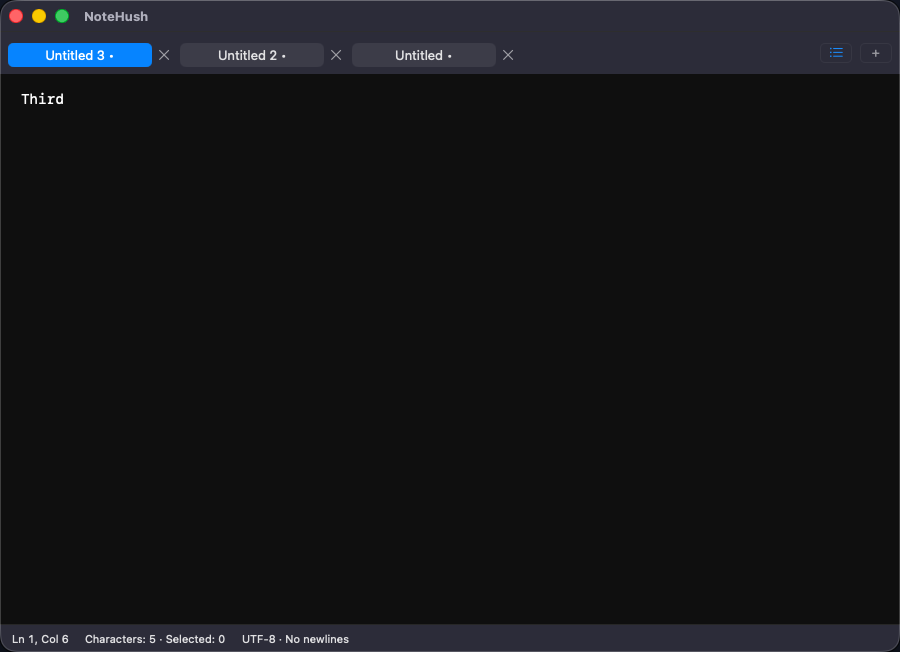

# Tab management validation — issue #10

Date: 2026-09-06. Branch: `issue-10/tab-management`, based on main `ae051dc7a5a8efb6432089d0a84207dac37d4bed`. Version remains 0.1.0 (1), pre-release.

Environment: MacBook Pro Mac16,8, M4 Pro, 24 GB RAM; macOS 26.6.2 (25G83); Xcode 26.6 (17F113), Swift 6.3.3, XcodeGen 2.46.0. Native tests use ad-hoc signing and isolated workspaces. Minimum-OS and Intel runtime qualification remain open.

## Behavior and evidence

- Drag titles or use Cmd+Control+Shift+[ / ] to reorder. The selected editor, selection, scroll and open-tab undo manager stay intact. Order and selection restore after restart.
- Close buttons and Cmd+W retain the newest 20 closed snapshots. Closing a background tab keeps selection; closing the active tab selects its right neighbor, or the left neighbor at the end. Closing the last tab creates one blank tab. Cmd+Shift+W/red close and Cmd+Q quit and restore the workspace; Cmd+W closes Settings when it is key.
- Cmd+Shift+T restores the newest closed draft to its original position, including Unicode text, selection, scroll and file binding. If the file is already open, the closed text reopens as an unbound draft for Save As. Accepted Save disables tab management until final metadata is available; typing during that save remains in the closed draft.
- File → Clear Recently Closed Tabs explicitly clears history. Schema 5 validates history, reads schemas 1–5 and retains previous raw migration generations. Old closed text is removed from the healthy backup only after a complete primary checkpoint is published. Failed publication, interrupted cleanup, coalesced close/clear and same-revision retry are tested. Damaged evidence and external backups/exports are not secure-erased.
- Native tab buttons retain identity across selection and typing. Names include position and unsaved state; close controls have explicit names. Native view order follows displayed order for accessibility. The strip scrolls selected tabs into view, and the All Tabs menu exposes every tab. AppKit tests inspect 100 tabs at minimum width; UI tests exercise scrolling, menu access and shortcuts.

## Executed checks

`bash scripts/check.sh` completed all stages successfully:

| Check | Result |
| --- | --- |
| Configuration, documentation links and strict Swift formatting | Passed |
| Core XCTest | 65 passed |
| AppKit integration XCTest | 25 passed |
| Sandboxed XCUITest | 26 passed, including the separate offline-volume phase |
| Child-process SIGKILL drills | 6 passed; acknowledged checkpoints restored intact |
| Unsigned Debug build | Passed |
| Universal Release archive and metadata | Passed; arm64 + x86_64, version 0.1.0 (1) |

Total: 116 tests plus six crash drills. Final full-run bundles: `build/logs/Lifecycle-7FAFAB2A-0019-44F2-9075-EE90A90C9981.xcresult` and `build/logs/OfflineVolume-E143133A-C9FC-4176-86C9-B0B7A07E6C4A.xcresult`. Logs remain in `build/logs/`; GitHub CI retains its own evidence. The repository now resolves to `Orbitane-Limited/NoteHush`; the local remote was updated and its self-hosted runner was verified online. Main was still the base commit above.

The focused suite also passed six AppKit tab cases and three sandboxed UI cases. The first full run found the shared file test lookup still expected a filename-only tab label; it now asserts the exact new position-bearing label. A subsequent run passed AppKit checks but Xcode timed out enabling UI automation before any UI case started. After confirming the Mac was unlocked, the complete pipeline passed. No timeout was extended, failed case skipped or forced teardown counted as successful Quit.

The screenshot below comes from the passing focused UI run (`Test-NoteHush-2026.09.06_13-20-09-+0500.xcresult`). It captures only the isolated NoteHush window and was visually inspected: selected/unselected tabs, dirty markers, close controls, overflow/new buttons and editor/status text are readable in dark appearance.

## Investigation and remaining gates

Development tests found an invalid NSStackView removal during initial insertion and an accessibility-order mismatch after reordering. Restacking retained controls only when identities/order change resolved both; no custom duplicated accessibility tree remains. A selection fixture initially split a composed Unicode cluster; it now selects a complete logical line fragment and asserts the selection both before closure and after restoration. No behavior assertion was removed to obtain a passing result.

Functional 100-tab coverage is not a performance benchmark. Per-tab blob storage, latency/RSS/energy budgets, many large tabs plus 20 closed drafts, VoiceOver/full keyboard access, real IME sources, minimum macOS and Intel runtime remain M5 gates. Production signing, TestFlight, physical printer checks and App Store release assets remain M6 gates. No release or App Store upload was made.
