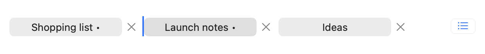
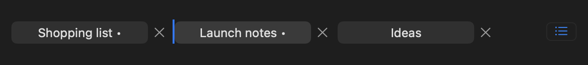

# Tab insertion indicator — 2026-09-08

Issue #54, branch `issue-54/tab-drag-indicator`, code commit `376d83b7d81688431b9670cfbd9c246f8b4028e4`, based on main `2c786fac01a59e548475c20f985050c0a430e992`. Local date is 2026-09-08 in Asia/Karachi; commands ran on 2026-09-07 UTC.

## Problem and change

Debug, Release and optimized builds of the combined validation candidate reported an AppKit deprecation warning in `TabBarView`: `borderType` applies only to old-style boxes. The insertion indicator uses a custom box. The installed Xcode 26.6 macOS SDK's `NSBox.h` documents `borderWidth` for custom boxes with a default of one point, which can occupy the entire two-point indicator. Its transparency property disables drawing altogether.

Set `insertion.borderWidth = 0` so the existing accent fill draws without the custom box's border. The indicator's frame, visibility changes, drag/drop callbacks and tab ordering are unchanged. Apple's public reference is [NSBox.borderWidth](https://developer.apple.com/documentation/appkit/nsbox/borderwidth); the installed SDK declarations were also inspected. Native visual appearance remains unverified.

## Executed validation

- Storage preflight passed using the unchanged issue #48 guard, imported with this worktree as its output root. It deletes nothing.
- Configuration, documentation links, strict Swift formatting and whitespace checks passed.
- Debug build and universal unsigned Release archive passed; both arm64 and x86_64 and existing privacy/version/isolation checks passed.
- The `borderType` warning and all `TabBarView.swift` warnings are absent from both new build logs. Xcode still emits its informational App Intents metadata warning because the app does not link AppIntents.
- No native app or GUI tests were launched, and no Store signing, installation or screenshot result is claimed.

Commands and full build output remain ignored under `build/check_indicator_builds.sh` and `build/logs/indicator-*`, plus `build/logs/release-archive.log`. This low-impact drawing-property change adds no test that merely repeats the implementation. Existing tab-management coverage remains required before merge.

## Pending acceptance

Run `TabManagementTests` and `TabManagementUITests.testPointerAndKeyboardReorderKeepSelectionAndRestoreOrder` in the confirmed exclusive-input window, along with required full CI. Visually verify the insertion indicator during native drag in light and dark appearance. Review must be resolved before squash merge. Parent #13 retains its full accessibility and supported-system acceptance.

The engineering version remains `0.1.0 (1)`. No issue was closed, no PR was opened, and main was not changed by this preparation.

## Native appearance inspection — 2026-09-08 UTC

The exact production `TabBarView.swift` from `a00c084` was compiled into a private AppKit renderer with three generated, minimal tab models. An offscreen native window rendered the real view in Aqua and Dark Aqua at 2× scale. Only the existing insertion box was exposed at its production 2-by-26-point geometry; this is an appearance fixture, not a simulated claim of a pointer drag. No desktop/user window was captured, no input was sent, and no clipboard was read. The shipping source was unchanged.

Visual inspection confirms the full accent-colored line is visible without a border in both appearances, beside readable tab titles and close/overflow controls. The fixture also confirms the actual custom box has zero border width. Existing native pointer/keyboard reorder CI remains required for real drag callbacks and restored tab order; the rendering does not replace it or parent #13 accessibility acceptance.

Private renderer source, build log and numeric report remain under the root checkout's `build/tab-indicator-visual/`. The render completed successfully with no warning; no assertions or timeouts were changed.
